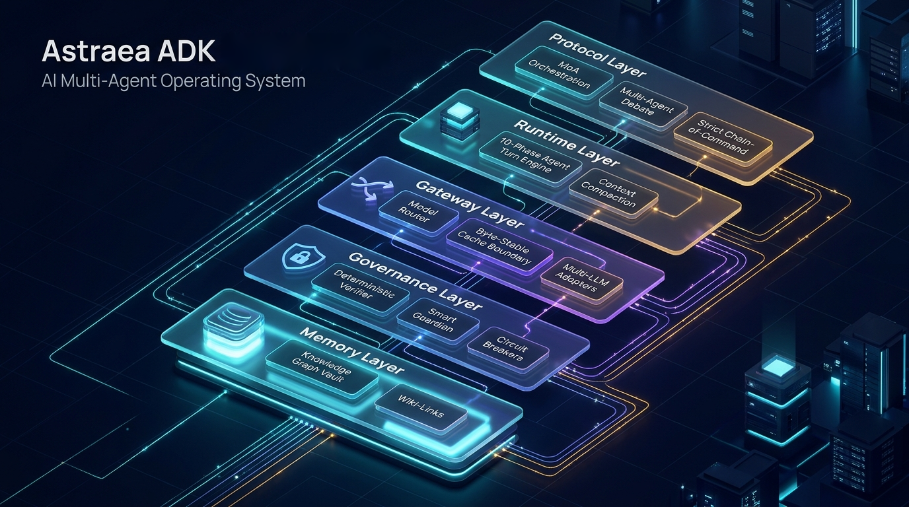

# Astraea-ADK (`LegionADK`)

[](https://www.python.org/)
[]()
[](documentation.md)
[](LICENSE)

**Astraea-ADK** (`LegionADK`) adalah runtime eksekusi agen tunggal dan multi-agen (*Mixture-of-Agents*) untuk Python. Inti framework ini dibangun hanya di atas pustaka standar Python, `pydantic>=2.0`, dan `httpx` — tanpa ketergantungan pada database vektor eksternal, server graf, maupun lapisan pembungkus (*wrapper*) prompt yang berat.



---

## Masalah Teknis yang Diselesaikan

Framework agen umumnya bermasalah ketika dibawa ke beban kerja nyata karena empat hal:

1. **Invalidasi Prompt Cache Antar-Turn**: Menyisipkan konteks dinamis di tempat yang salah atau urutan deklarasi *tool* yang berubah-ubah membuat *prefix cache* pada penyedia LLM selalu meleset (*cache miss*).
2. **Konteks Membengkak karena Output Tool & RAG**: Membuang seluruh isi dokumen *skill* ke *system prompt* atau membiarkan satu panggilan *tool* mengembalikan ratusan kilobyte teks mentah langsung ke riwayat pesan.
3. **Biaya & Latensi Ekstraksi Memori**: Menggunakan panggilan LLM tambahan hanya untuk mengekstrak *entity/triple* pengetahuan atau meminta LLM mengulang panggilan ketika JSON `tool_calls` terpotong batas `max_tokens`.
4. **Konflik Tulis pada Agen Paralel**: Beberapa agen yang dieksekusi bersamaan melalui `asyncio.gather` memodifikasi state atau berkas yang sama tanpa penguncian (*locking*) dan tanpa kontrol konkurensi.

---

## Arsitektur & Mekanisme Internal

| Modul | Mekanisme Teknis |
| :--- | :--- |
| **`core/`** | Kontrak identitas `LLMSpec`, amplop komunikasi `MessageEnvelope`, dan `CancellationToken` (mendukung `pause()`/`resume()` terpisah dari `cancel()`). Seluruh struktur bersarang dikunci *immutable* menggunakan `MappingProxyType`. |
| **`gateway/`** | Memisahkan identitas statis dan konteks giliran dengan penanda `LEGION_CACHE_BOUNDARY` (diverifikasi via SHA-256), mengekspor skema *tool* secara terurut alfabetis, menangani *rate-limit* RPM/TPM beserta *cooldown failover* per provider, dan menambal JSON `tool_calls` yang terpotong dengan parser *stack LIFO* di RAM. |
| **`tools/`** | Registri *tool* in-memory dengan otorisasi RBAC (`exact`, `namespace:*`, `*` / `ALL`) dan **50 KB Output Spill Guard** (`51.200 bytes`) yang memotong luapan teks secara aman pada batas karakter UTF-8 multi-byte serta menyimpan output utuh ke disk. |
| **`governance/`** | `DeterministicVerifier` (CoV) memeriksa argumen *tool* berisiko (`risk_tier >= 1`) terhadap *path traversal* dan injeksi perintah sebelum dieksekusi, lalu mengembalikan pesan penolakan ke riwayat `role: "tool"` agar model melakukan *self-repair*. Dilengkapi `ToolCircuitBreaker` (berbasis hash tanda tangan panggilan) dan eskalasi sesi monoton via `SmartGuardian`. |
| **`runtime/`** | Siklus eksekusi 10 fase *stateless* (`execute_turn`) dengan kompresi konteks dua lapis di RAM (`compact_context_two_tier`): memangkas output *tool* lama menjadi ringkasan 1 baris (Tier 1) dan menggulung separuh riwayat terlama menjadi blok ringkasan (Tier 2) tanpa menyentuh jangkar *system prompt*. |
| **`memory/`** | **Autonomous Graph Memory** di atas folder berkas Markdown (`.md`). Memindai *frontmatter*, heading, dan `[[wikilink]]` dalam mode biner (`rb`), mencatat `(start_byte, end_byte)` setiap sub-bab, serta menyajikan pengetahuan dalam 3 langkah: pencarian pintu masuk dengan **Okapi BM25** (`graph:locate`), pembacaan struktur sub-bab di RAM (`graph:inspect_outline`), dan pembacaan irisan byte sub-bab via `seek()` (`graph:read_section`). |
| **`protocol/`** | Orkestrator multi-agen yang mendukung debat paralel (`run_moa_debate`), triase mandiri oleh koordinator (`run_autonomous_triage`), serta delegasi hierarkis berjenjang (*Strict Chain-of-Command*) dengan proteksi siklus tumpukan panggilan (*anti-cycle call stack guard*) dan pemblokiran *tool* mutasi (`risk_tier >= 1`) selama fase *brainstorming* paralel. |

---

## Hasil Benchmark

Klaim efisiensi dan ketahanan di atas diukur dengan suite benchmark internal yang terdiri dari dua pilar: **Pilar A** mengukur efisiensi murni mesin (CPU, RAM, dan token) dengan mock LLM 0 ms agar yang terukur adalah overhead engine, bukan kecepatan provider; **Pilar B** menguji perilaku framework terhadap skenario yang dimodelkan pada standar benchmark agentik internasional (BFCL v3, TAU-bench, LOCOMO/LongMemEval, dan GAIA). Hasil berikut diperoleh dari paket distribusi `astraea-adk` 1.0.1 yang terpasang dari PyPI:

| Kode | Kategori | Benchmark | Hasil Pengukuran | Status |
| :---: | :--- | :--- | :--- | :---: |
| **E1** | Pilar A (Engine) | Cold-Start Import & RAM Footprint | `1321.84 ms \| Peak RAM: 10.06 MB` | **PASS (< 50 MB)** |
| **E2** | Pilar A (Engine) | 10-Phase Engine Overhead (100 Tool Turns) | `962.5 ms total (9.62 ms/turn)` | **PASS (< 10 ms/turn VM)** |
| **E3** | Pilar A (Engine) | Byte-Stable Prefix & Tool Cache Retention | `100% Identik Lintas 20 Turn` | **PASS (0 Drift)** |
| **E4** | Pilar A (Engine) | Progressive Disclosure Token Efficiency | `Baca 20/42872 tok (Hemat 99.95%, 16.3ms)` | **PASS (> 95% Hemat)** |
| **E5** | Pilar A (Engine) | LIFO Stack Malformed JSON Recovery (50x) | `50/50 Pulih \| 16.39 ms \| 0 LLM Retry Tok` | **PASS (100% Pulih)** |
| **B1** | Pilar B (BFCL v3) | Multi-Step Dependent Tool Chain + Repair | `3/3 Hop Sukses \| 4 Rounds` | **PASS (100% Akurat)** |
| **B2** | Pilar B (TAU-bench) | Policy Compliance, RBAC Block & CoV Repair | `0 Breach \| 1 RBAC Block \| 1 CoV Self-Repair` | **PASS (100% Aman)** |
| **B3** | Pilar B (LOCOMO) | 40-Turn Compaction + Persistent Graph Recall | `Hist: 5142->746 tok \| Recall: 100%` | **PASS (Budget & Recall OK)** |
| **B4** | Pilar B (GAIA Live) | Multi-Agent MoA Triage & Tool Reasoning | Lihat perbandingan dua mode di bawah | **PASS (Live Verified)** |

### Penjelasan per Benchmark

**Pilar A — Efisiensi Mesin**

- **E1, Cold-Start Import & RAM Footprint.** Mengukur waktu import seluruh permukaan publik framework beserta puncak pemakaian RAM via `tracemalloc`. Hasil 1,3 detik dengan puncak hanya 10,06 MB menunjukkan framework ringan untuk dijalankan di proses berumur pendek seperti serverless atau CLI, tanpa beban dependensi berat di luar `pydantic` dan `httpx`.
- **E2, Pure 10-Phase Turn Engine Overhead.** Menjalankan 100 giliran agen lengkap (preflight, perakitan prompt, panggilan tool, verifikasi, finalisasi) melawan router mock 0 ms, sehingga angka yang terukur murni biaya CPU siklus `execute_turn` itu sendiri: 962,5 ms total atau 9,62 ms per giliran pada VM pengujian bersama. Verdict pada benchmark ini dinamis mengikuti hasil ukur aktual di mesin yang menjalankan.
- **E3, Byte-Stable Cache Boundary Retention.** Selama 20 giliran, urutan izin tool diacak dan konteks dinamis diubah drastis di setiap giliran, lalu digest SHA-256 prefix sistem dan skema tool diperiksa. Keduanya 100% identik di semua giliran, artinya prefix yang dikirim ke provider tidak pernah bergeser dan *prompt caching* tidak terinvalidasi oleh perubahan konteks dinamis maupun urutan deklarasi tool.
- **E4, Graph Memory Progressive Disclosure vs Full-Vault RAG.** Sebuah vault berisi 15 berkas runbook (total 42.872 token) menyimpan satu parameter kritis di sub-bab satu berkas. Pendekatan RAG konvensional akan memuat seluruh vault ke konteks; graph memory cukup melakukan `graph:locate` (BM25), membaca outline, lalu membaca satu irisan byte sub-bab: total 20 token terbaca, hemat 99,95%, dalam 16,3 ms, tanpa satu pun panggilan LLM untuk ekstraksi.
- **E5, Zero-Token Malformed Tool-Call Recovery.** Lima puluh sampel JSON argumen tool yang rusak atau terpotong (termasuk literal Python dan kurung di dalam string) diperbaiki oleh parser stack LIFO di RAM. Seluruhnya pulih menjadi objek yang valid dalam 16,39 ms total, tanpa satu token pun dibelanjakan untuk meminta model mengulang panggilan.

**Pilar B — Standar Agentik Internasional**

- **B1, BFCL v3 (Multi-Step Dependent Tool Chains).** Menguji rantai fungsi berketergantungan tiga langkah, di mana output tool pertama menjadi input tool kedua dan seterusnya, dengan argumen JSON terpotong yang sengaja disisipkan di langkah pertama. Rantai selesai 3/3 hop dalam 4 putaran: perbaikan JSON bekerja di tengah rantai tanpa menggagalkan eksekusi.
- **B2, TAU-bench (Policy Compliance, RBAC Block, & CoV Self-Repair).** Agen dihadapkan pada dua serangan dalam satu giliran: memanggil tool destruktif di luar izin RBAC dan menulis ke path traversal `../../etc/shadow`. Keduanya gagal total dengan aman (0 breach): panggilan pertama diblokir RBAC, yang kedua ditolak `DeterministicVerifier`, dan agen melakukan *self-repair* dari pesan penolakan hingga menyelesaikan tugas di path yang sah.
- **B3, LOCOMO / LongMemEval (Compaction + Long-Term Recall).** Riwayat percakapan 40 pesan (5.142 token) dikompresi oleh *two-tier compaction* menjadi 746 token di bawah budget 800, dengan jangkar system prompt tetap utuh di posisi pertama. Fakta persisten lintas sesi yang tersimpan di graph memory berhasil ditarik kembali dengan recall 100%, membuktikan kombinasi memori sesi terkompresi dan memori jangka panjang berbasis Markdown.
- **B4, GAIA (Multi-Hop Reasoning & Cross-Domain Synthesis).** Satu-satunya benchmark yang dijalankan dengan LLM asli (`deepseek-v4.1-flash`): soal perhitungan biaya klaster lintas domain yang datanya hanya tersedia lewat tool telemetri, diberikan kepada tim `@cos`, `@cto`, dan `@pm`. Dua run live menghasilkan dua jalur eksekusi berbeda, keduanya benar dan terverifikasi, seperti dirinci pada sub-bab berikut.

### Perbandingan Dua Mode Eksekusi pada B4

| Mode Eksekusi | Jalur Eksekusi | Waktu | Prompt Token | Status |
| :--- | :--- | ---: | ---: | :---: |
| **AUTONOMOUS_TRIAGE** | `@cos` mendelegasikan ke `@cto` + `@pm` (masing-masing memanggil tool telemetri), lalu menyintesis | 29.405 ms | 14.663 | **PASS (Live Verified)** |
| **STANDALONE** | `@cos` memanggil tool telemetri dan menjawab sendiri tanpa delegasi | 11.094 ms | 3.450 | **PASS (Live Verified)** |

Mode eksekusi pada B4 bukan setting statis, melainkan hasil keputusan model pada giliran pertama koordinator `@cos`. Soal, roster, dan tool identik di kedua run; yang berbeda hanya strategi yang dipilih model saat runtime. Jika koordinator mengeluarkan `comm:delegate`, orkestrasi berjalan sebagai **AUTONOMOUS_TRIAGE**: para spesialis bekerja paralel dari sudut pandangnya masing-masing dan koordinator menyintesis hasilnya, dengan konsekuensi putaran LLM, token, dan waktu yang lebih besar namun dengan pembagian kerja dan sintesis lintas peran. Jika koordinator menilai soal cukup diselesaikan sendiri (ia juga memegang izin tool telemetri), giliran selesai sebagai **STANDALONE**: satu agen, satu pemanggilan tool, jawaban langsung, jauh lebih hemat token dan waktu. Keduanya menghasilkan angka akhir yang sama dan benar (biaya tanpa cache $6.000/hari, dengan 90% cache hit $1.140/hari, penghematan $4.860/hari). Engine tidak memaksa satu jalur; ia mengikuti strategi yang dipilih model, dan perilaku ini dapat diarahkan lewat system prompt koordinator atau `OrchestrationPolicy` bila pengguna menginginkan delegasi selalu atau penyelesaian mandiri selalu.

> Catatan metodologi: angka latensi Pilar A di atas diukur pada VM bersama (shared CPU) dan akan lebih cepat pada hardware lokal atau server khusus. Seluruh skenario dapat direproduksi dengan `python test/benchmark_suite.py`, dan mode live B4 dengan `LEGION_LIVE_BENCH=1 python test/benchmark_suite.py`.

---

## Instalasi & Konfigurasi

Instal paket distribusi biner menggunakan `pip`:

```bash
pip install astraea-adk
```

Salin berkas konfigurasi contoh `examples/.env.example` menjadi `.env` di direktori kerja Anda:

```dotenv
CUSTOM_PROVIDER_API_KEY=your_api_key_here
CUSTOM_PROVIDER_BASE_URL=https://api.your-provider.com/v1

TEST_PRIMARY_PROVIDER=custom
TEST_PRIMARY_MODEL=deepseek-v4.1-flash

# Opsional — Provider Resmi & Lokal:
# OPENAI_API_KEY=sk-...
# ANTHROPIC_API_KEY=sk-ant-...
# GEMINI_API_KEY=AIzaSy...
# OLLAMA_BASE_URL=http://localhost:11434/v1
# VLLM_BASE_URL=http://localhost:8000/v1
```

---

## Contoh Penggunaan Cepat

### 1. Orkestrasi Multi-Agen & Strict Chain-of-Command (`LegionADK.protocol`)

Fungsi `dispatch_envelope` menganalisis target amplop dan memilih jalur eksekusi secara otomatis:

- **Triase Otonom (AUTONOMOUS_TRIAGE)**: Jika pesan dikirim ke satu koordinator (misal `@cos` atau `@secretary`), koordinator mengevaluasi direktori tim dan mendelegasikan tugas ke spesialis yang relevan.
- **Debat Eksplisit (EXPLICIT_MOA)**: Jika pesan ditujukan ke ≥ 2 agen atau menyebut beberapa `@handle`, para Proposer berjalan paralel lalu disintesis oleh `@Aggregator`.
- **Agen Tunggal (STANDALONE)**: Jika pesan ditujukan ke satu agen biasa tanpa delegasi.

```python
import asyncio
from LegionADK import (
    AgentRoster,
    LLMSpec,
    OrchestrationPolicy,
    contract_message,
    dispatch_envelope,
)

roster = AgentRoster([
    LLMSpec(
        handle="@cos",
        agent_name="Chief of Staff",
        soul_prompt="Koordinator yang memetakan masalah ke kepala divisi terkait.",
        system_prompt="Gunakan comm:delegate untuk menugaskan analisis teknis ke @cto dan produk ke @pm.",
        tool_permissions=["comm:delegate"],
    ),
    LLMSpec(
        handle="@cto",
        agent_name="Chief Technology Officer",
        soul_prompt="Fokus pada keandalan sistem, isolasi proses, dan struktur data.",
        system_prompt="Berikan spesifikasi teknis yang terukur.",
        tool_permissions=["comm:delegate"],
    ),
    LLMSpec(
        handle="@pm",
        agent_name="Product Manager",
        soul_prompt="Fokus pada jadwal rilis, ruang lingkup fitur, dan mitigasi risiko bisnis.",
        system_prompt="Berikan batasan rilis dan prioritas eksekusi.",
    ),
])

async def main() -> None:
    env = contract_message(
        sender="@user",
        target=["@cos"],
        content="Rancang rencana mitigasi lonjakan beban API 300% tanpa menurunkan kualitas respons.",
    )

    result = await dispatch_envelope(
        envelope=env,
        roster=roster,
        policy=OrchestrationPolicy(
            max_discussion_rounds=1,
            max_delegation_depth=3,
            allow_proposer_tier1_mutations=False,
        ),
    )

    print(f"Mode & Status : {result.mode} | {result.status}")
    print(f"Proposers     : {list(result.proposer_handles)}")
    print(f"Token Usage   : prompt={result.total_prompt_tokens}, cached={result.total_cached_tokens}")
    print(result.final_content)

asyncio.run(main())
```

### 2. Autonomous Graph Memory (`LegionADK.memory`)

Mendaftarkan 4 tool navigasi dan penulisan pengetahuan di atas folder Markdown lokal (kompatibel dengan vault Obsidian maupun berkas `SKILL.md` open-source):

```python
from pathlib import Path
from LegionADK import register_graph_memory_tools

# Mendaftarkan:
# 1. graph:locate (tier 0 - pencarian Okapi BM25 + peta tetangga 1-hop EXTRACTED > INFERRED)
# 2. graph:inspect_outline (tier 0 - daftar sub-bab, estimasi token, & content_hash di RAM)
# 3. graph:read_section (tier 0 - baca irisan byte sub-bab via seek() + 50KB spill guard)
# 4. graph:learn_and_link (tier 1 - tulis/append/replace atomik dengan OCC hash & Jaccard check)
memory = register_graph_memory_tools(
    vault_path=Path("./vault"),
    skill_gate=lambda session_id: True,
    max_mutations_per_session=5,
)

health = memory.check_health()
print(f"Nodes: {health.total_nodes}, Edges: {health.total_edges}, Orphans: {health.orphan_nodes}")
```

---

## Menjalankan Skrip Contoh (`examples/`)

Repositori ini menyertakan 4 skrip contoh siap pakai di dalam direktori `examples/`:

| Berkas | Deskripsi |
| :--- | :--- |
| `examples/01_quickstart_moa_debate.py` | Diskusi eksplisit multi-putaran antar-spesialis (`run_moa_debate`) yang disintesis oleh agregator. |
| `examples/02_autonomous_triage.py` | Triase mandiri oleh koordinator (`run_autonomous_triage`) dan pendelegasian berjenjang (*Strict Chain-of-Command*). |
| `examples/03_secure_governance.py` | Demonstrasi RBAC, penolakan *path traversal* oleh `DeterministicVerifier` (CoV), *self-repair* agen, dan eskalasi `SmartGuardian`. |
| `examples/04_graph_memory.py` | Penelusuran bertahap 3-lapis pada `MarkdownGraphMemory` dan penulisan pengetahuan baru secara atomik. |

Jalankan contoh langsung dari terminal:

```bash
python examples/01_quickstart_moa_debate.py
python examples/02_autonomous_triage.py
python examples/03_secure_governance.py
python examples/04_graph_memory.py
```

Referensi lengkap seluruh kelas kontrak, tanda tangan fungsi, dan parameter tersedia di `documentation.md`.

---

## Lisensi

Proyek ini dilindungi di bawah lisensi Proprietary & Confidential. Hak Cipta © HillarioRZA.
